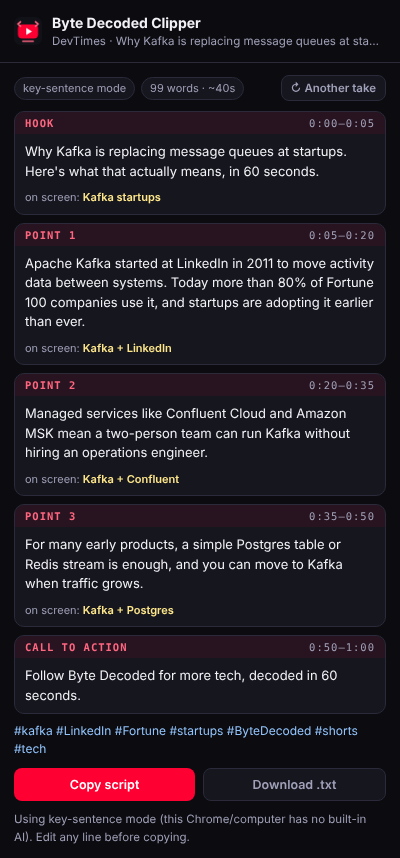

# ✂️ Byte Decoded Clipper

**Turn any tech article into a 60-second YouTube Short script**, built for my channel [Byte Decoded](https://www.youtube.com/@shreejith-l7o).

<p align="center"></p>

## What you get

- **Timed script:** hook (0:00–0:05) → 3 key points (to 0:50) → call to action (to 1:00).
- **On-screen text** for each part, and **hashtags**.
- **Word count and length estimate** (about 150 spoken words a minute); it turns red if you'll run over a minute.
- **Edit any line** right in the popup, then **Copy** or **Download .txt** (with the source link at the end).
- **Another take:** a different hook style and different points.

## How it writes the script (free either way)

1. **Chrome's built-in on-device AI** (Gemini Nano, via the Prompt API) when your computer supports it. The first time, the popup offers a one-time model download. It runs on your machine, costs nothing and never sends the article anywhere.
2. **Key-sentence mode** everywhere else. It scores every sentence by how many of the article's key terms it uses (numbers and "you" score higher, sentences that need context score lower), picks the best one from each third of the article so the Short covers the whole story, and adds the following sentence when it still fits. Captions use the article's named things (Kafka, Redis, LinkedIn…).

## Privacy

It reads a page **only when you click the icon** (`activeTab`) and has no network access at all.

## Install (2 minutes)

1. Download this repo: **Code → Download ZIP**, then unzip it (or `git clone` it).
2. Open `chrome://extensions` in Chrome (or Edge / Brave).
3. Turn on **Developer mode** (top right).
4. Click **Load unpacked** and choose the unzipped folder (the one with `manifest.json`).
5. Pin it from the 🧩 puzzle-piece menu so it is one click away.

Then open any article, click the icon, and edit.

## Tests

`tests/test.js` loads the extension into headless Chromium with [Playwright](https://playwright.dev), opens realistic mock pages and checks the results end to end (screenshots go to the folder you pass in):

```bash
npm i -D playwright && npx playwright install chromium
node tests/test.js /tmp
```
